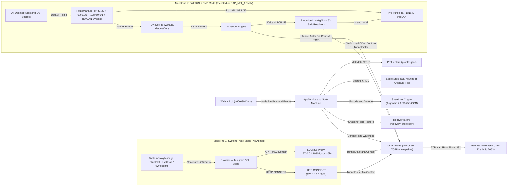

# Architecture & Build Blueprint: Cross-Platform SSH Desktop Tunnel Client

- **Default Module / App Name:** `tunssh` (parameterized Go module `github.com/<user>/tunssh`, binary `tunssh` on Linux / `tunssh.exe` on Windows)
- **Target Platforms:** Desktop Linux (`amd64`, `arm64`) and Windows (`amd64`, `arm64`)
- **Primary Stack:** Go (`1.23+`) + Wails v2 (`github.com/wailsapp/wails/v2`) + minimal dark-first web UI (~15–20 MB single binary per OS)
- **Server Dependency:** Zero server-side installation — connects directly to stock Linux OpenSSH (`sshd` with `AllowTcpForwarding yes`)
- **Distribution Model:** Free, open-source, self-contained binary for personal and friends' use (zero monetization, zero telemetry, zero external control plane)

---

## 1. Executive Overview & Strict Two-Milestone Agent Charter

### 1.1 Purpose & Scope
`tunssh` is a minimalist, NPV-like 1-click desktop SSH tunnel client built specifically to eliminate the recurring failure modes of multi-protocol proxy GUIs (`Hiddify`, `Nekoray`, `v2rayN`) when tunneling through plain OpenSSH on a VPS:
1. **`keyboard-interactive` (PAM) Auth Failures:** Stock Ubuntu/Debian `sshd` defaults often reject raw SSH `password` authentication while accepting PAM `keyboard-interactive`.
2. **UDP DNS Hangs & Leaks:** Standard SSH (`direct-tcpip`) only forwards TCP streams; OS/browser UDP port `53` lookups silently hang or leak to ISP DNS unless handled explicitly via remote hostname resolution (Milestone 1) or embedded TCP/DoH DNS interception (Milestone 2).
3. **Silent Zombie Sockets:** Iranian ISP throttling, DPI resets, and Wi-Fi/hotspot switches drop idle TCP states without sending `FIN`/`RST`, freezing passive SSH connections until OS TCP timeouts expire.
4. **Dirty OS Network State After Crashes:** Force-kills, OS reboots, or BSODs leave system proxy keys, split routes, or `/etc/resolv.conf` entries stranded, breaking internet connectivity until manually repaired.
5. **Clunky Friend Onboarding:** Sharing raw IP/username/password strings over messengers is error-prone and insecure; encrypted `sshtun://v1/...` links enable safe 1-click import with pinned host keys.

**Explicit Non-Goals:**
- No VMess/VLESS/Trojan/Xray/Hysteria protocol cores and no server-side helper daemon.
- No macOS, Android, or iOS builds in this repository.
- No billing, user accounts, telemetry, or remote subscription servers.

### 1.2 Strict Milestone Ordering Charter (Mandatory Agent Gate)
Implementing agents **MUST build, test (`go test -race ./...`), verify end-to-end, and tag Milestone 1 FIRST** before creating or enabling any Milestone 2 implementation (`internal/tun`, `internal/dns`, `internal/splitroute`, `wintun.dll`, `netlink`, or privilege elevation).

| Dimension | Milestone 1: Usable Day 1 (`System Proxy Mode`) | Milestone 2: Full NPV-Like Mode (`Full TUN + DNS`) |
| :--- | :--- | :--- |
| **Privileges Required** | **Zero** (runs strictly unprivileged — no `sudo`, no UAC, no drivers) | Elevated only when activating TUN (`UAC` helper on Windows; `pkexec` or `setcap cap_net_admin,cap_net_bind_service+ep` on Linux) |
| **Core Tunnel Engine** | Go `x/crypto/ssh` client (`password`, `keyboard-interactive`, `ed25519`/`rsa`), TOFU SHA-256 pinning, active `keepalive@openssh.com` watchdog, lock-free epoch auto-reconnect | Reuses Milestone 1 `TunnelDialer` unchanged |
| **Local Data Plane** | Loopback SOCKS5 (`127.0.0.1:10808`, `socks5h`) + HTTP CONNECT (`127.0.0.1:10809`) | `tun2socks` (`github.com/xjasonlyu/tun2socks/v2`) over `Wintun` (Windows) / `/dev/net/tun` (Linux) |
| **DNS Resolution** | Remote hostname forwarding (`ATYP=0x03` & `CONNECT host:port`) resolved on VPS | Embedded `github.com/miekg/dns` intercepting `:53` → DNS-over-TCP (`1.1.1.1:53` / `8.8.8.8:53`) or DoH via `TunnelDialer`; `.ir`/LAN via pre-tunnel ISP DNS |
| **OS Integration** | Windows Registry + `WinINet`; Linux `gsettings` (GNOME) / `kwriteconfig5|6` (KDE) + copyable env bar | Split-tunnel routing (`<VPS_PEER_IP>/32` pinned on original gateway, `0.0.0.0/1` + `128.0.0.0/1` via TUN, RFC1918 + optional `.ir`/Iran CIDR bypass) |
| **UX & Ops** | Wails v2 dark-first `460x680` GUI, tray, OS Keyring + encrypted file fallback, `sshtun://` share links, crash-safe `recovery_state.json`, redacted live logs | Activates the `Full TUN (All Apps)` segmented toggle + `Bypass Iran (.ir) & LAN` route & DNS bypass |

> **Milestone Boundary Rule:** During Milestone 1, `Full TUN` stays visually labeled as disabled/Milestone 2 in the UI or gated behind a compile-time/runtime capability check, with zero privileged OS routing mutations or `wintun.dll` dependencies pulled into M1 builds.

---

## 2. Critical SSH & Networking Failure Modes Solved by Design

### 2.1 SSH Authentication & TOFU Host-Key Security
1. **Multi-Auth Ordering & PAM (`keyboard-interactive`) Support:**
   - **Failure Mode:** Default Ubuntu/Debian `sshd` configurations frequently disable `PasswordAuthentication` and rely on `KbdInteractiveAuthentication yes` (`UsePAM yes`). Clients passing only `ssh.Password(...)` fail immediately.
   - **Design Invariant:** When `Profile.AuthType == AuthPassword`, `internal/sshclient/auth.go` populates `ssh.ClientConfig.Auth` with **both** `ssh.PasswordCallback` and `ssh.KeyboardInteractive`:
     - The `KeyboardInteractive` callback inspects `questions []string` and `echos []bool`:
       - If `len(questions) == 0` (PAM informational pre-auth banner), return `[]string{}, nil` cleanly.
       - For non-echo or password-like prompts (`!echos[i]` or case-insensitive substring `"password"` / `"passcode"`), supply the secret from `SecretStore`.
       - Enforce a strict round counter (`maxKbdInteractiveRounds = 3`) per dial attempt so misconfigured PAM loops fail fast instead of hanging.
   - **Private Key Auth (`AuthKey`):**
     - Support `ed25519`, `ecdsa`, and `rsa` keys in OpenSSH / PEM / PKCS#8 format using `ssh.ParsePrivateKey` or `ssh.ParsePrivateKeyWithPassphrase`.
     - Validate key parsing **before** dialing TCP; if the key is encrypted (`*ssh.PassphraseMissingError`) and no passphrase is stored, fail fast with a mapped UI prompt rather than burning auth retries on the VPS.
2. **TOFU (Trust On First Use) SHA-256 Host-Key Pinning:**
   - **Hard Invariant:** `ssh.InsecureIgnoreHostKey()` is **STRICTLY FORBIDDEN** anywhere in application or production code.
   - Compute canonical fingerprint `fp := ssh.FingerprintSHA256(key)` and key algorithm `alg := key.Type()`.
   - **Deterministic Two-Step Verification (Zero `LoginGraceTime` Hang):**
     - Do **NOT** block inside `HostKeyCallback` waiting for user clicks (blocking the SSH handshake stalls the socket until `sshd` drops it on `LoginGraceTime`).
     - **Case A — No Pinned Key Stored:** `HostKeyCallback` captures the probed `{Algorithm: alg, SHA256: fp}` (or mismatch details) in a per-attempt closure variable in addition to returning a typed `ErrHostKeyUntrusted` error (preventing `x/crypto/ssh` error wrapping from obscuring structured fields) and returns immediately, closing the pre-auth TCP socket cleanly. The UI renders the **Trust Server Fingerprint** modal displaying `alg` and `SHA256:...`. Upon user confirmation, `AppService` persists `PinnedHostKey` into `profiles.json` and immediately re-invokes `Connect`.
     - **Case B — Pinned Key Matches:** Compare `alg == pinned.Algorithm` and constant-time equality (`subtle.ConstantTimeCompare`) on the decoded fingerprint bytes; allow handshake to complete.
     - **Case C — Pinned Key Mismatch:** Reject immediately with `ErrHostKeyMismatch{ExpectedAlg, ExpectedSHA256, ActualAlg, ActualSHA256}`. **NEVER** silently overwrite `PinnedHostKey`. Display a high-severity crimson MITM alert modal requiring the user to either abort (default) or explicitly click **"Forget & Re-trust Host Key"** (which clears `PinnedHostKey` and starts a fresh Case A confirmation).
   - **Share-Link Integration:** When a creator exports a profile via `sshtun://`, the sender's `PinnedHostKey` is included in the payload so friends get automatic MITM-protected verification on first connect without manual fingerprint comparison.

### 2.2 Active Keepalive Watchdog & Lock-Free Auto-Reconnect
1. **Active Keepalive Watchdog (`internal/sshclient/watchdog.go`):**
   - Spawn one watchdog goroutine bound to the active connection's `epoch` and `sessionCtx`.
   - Every `10s`, issue `sshClient.SendRequest("keepalive@openssh.com", true, nil)` raced against a `5s` timeout timer (because `golang.org/x/crypto/ssh` `SendRequest` lacks a `context.Context` parameter, execute the probe in a helper goroutine using a buffered channel `make(chan error, 1)` selecting on `done` vs `5s` timer vs `sessionCtx.Done()`, and enforce at most one in-flight probe per tick so timed-out probes—which serialize on `x/crypto/ssh`'s internal `globalSentMu`—cannot pile up or leak goroutines).
   - Track consecutive missed probes (`missedTicks`):
     - If a response arrives within `5s`, reset `missedTicks = 0` and record the measured `RTTMs` (used for the live UI RTT telemetry badge).
     - If `5s` expires without reply (or `SendRequest` returns error), increment `missedTicks`.
     - At `missedTicks >= 2`, immediately close the underlying raw `net.Conn` (`rawConn.Close()`) to force-unblock any hung `SendRequest` or `sshClient.Wait()`, abort the epoch cleanly, and enter the reconnect loop.
2. **Lock-Free Epoch / Generation Guard (Zero Deadlocks, Zero Stale Teardown):**
   - **Hard Invariant:** **ZERO mutex locks** (`sync.Mutex` / `sync.RWMutex`) may ever be held while calling `net.Dialer.DialContext`, `ssh.NewClientConn`, `SendRequest`, `sshClient.DialContext`, `rawConn.Close`, or `io.Copy`.
   - Maintain a monotonic `epoch atomic.Uint64` and `active atomic.Pointer[sshSession]` on the engine:
     - Each dial attempt claims `myEpoch := e.epoch.Add(1)` and creates `sessCtx, sessCancel := context.WithCancel(runCtx)`.
     - All state transitions (`onKeepaliveFailed`, `onWaitExited`, `onReconnect`) check `if e.epoch.Load() != myEpoch { return }` (or atomically compare state + epoch) before mutating state or scheduling reconnect, making it mathematically impossible for a dying goroutine from `epoch=N` to tear down `epoch=N+1`.
     - `TunnelDialer.DialContext` loads `sess := e.active.Load()` lock-free and calls `sess.sshClient.DialContext(ctx, network, addr)` directly.
3. **Bounded Exponential Backoff & Clean Cancellation:**
   - Unexpected network drops trigger backoff sequence: `1s → 2s → 4s → 8s → 16s → 30s` (capped at `30s`), applying `±20%` jitter using `crypto/rand` / `math/rand/v2`.
   - **Non-Retryable Terminal Errors:** `ErrHostKeyUntrusted`, `ErrHostKeyMismatch`, `ErrAuthFailed`, and invalid private-key passphrase errors MUST immediately halt reconnection and transition to `StateError` / `StateDisconnected` to prevent `fail2ban` IP lockouts on the VPS.
   - **Clean Disconnect:** `Disconnect(ctx)` increments `epoch`, cancels `runCtx` (immediately aborting any in-flight TCP dial or backoff sleep), closes `rawConn` and `ssh.Client` (terminating all active `direct-tcpip` channels instantaneously), and waits via `sync.WaitGroup` (bounded by `ctx`) to guarantee zero leaked goroutines or file descriptors.

### 2.3 TUN Routing-Loop Prevention (Milestone 2 Only)
To prevent SSH transport packets from re-entering the TUN interface in an infinite routing loop:
1. **Pre-TUN DNS Resolution:** Before creating the TUN device or modifying any routes, resolve `Profile.Host` using the pre-tunnel OS resolver (`net.DefaultResolver.LookupNetIP(ctx, "ip4", host)` explicitly for IPv4 `origGW` pinning, or `"ip6"` when explicitly connecting over an IPv6 VPS peer) to obtain a concrete `vpsPeerIP`. Cache this IP for the tunnel session; dial SSH exclusively to `net.JoinHostPort(vpsPeerIP.String(), port)` (while passing `Profile.Host:Profile.Port` as the TOFU host-key lookup key).
2. **Capture Snapshot First:** Snapshot original gateway (`origGW` / `origGW6`), original egress interface (`origIfaceName`, `origIfaceIndex`), real non-loopback upstream DNS servers per active interface (excluding `127.0.0.0/8` / `::1`) across **all active physical adapters (IPv4 + IPv6)** on Windows and active links on Linux, and IPv6 state; persist `recovery_state.json` (`dirty: true`) from the unprivileged GUI **before** mutating OS routes/DNS.
3. **Host Route Pinning + Socket Pinning:**
   - Install explicit host route `<vpsPeerIP>/32 via <origGW> dev <origIface>` (or `<vpsPeerIP>/128 via <origGW6> dev <origIface>` when connecting to an IPv6 VPS peer) **before** installing TUN default routes.
   - In `net.Dialer.Control` for the SSH TCP socket:
     - On Windows: bind socket egress interface with `IP_UNICAST_IF` (`setsockopt` — note `IP_UNICAST_IF` expects `htonl(ifIndex)` in network byte order for IPv4, whereas `IPV6_UNICAST_IF` expects host byte order) or local IP of `origIface`.
     - On Linux: when `CAP_NET_ADMIN` / `CAP_NET_RAW` is effective, bind `SO_BINDTODEVICE` to `origIfaceName` (when running unprivileged with `pkexec` helper, the `<vpsPeerIP>/32` route guarantees safe egress across reconnects).
4. **Split Default Routes (Never Overwrite `0.0.0.0/0`):**
   - Install `0.0.0.0/1` and `128.0.0.0/1` via the TUN interface (`198.18.0.1`). Because `/1` prefixes win longest-prefix match over `0.0.0.0/0`, all non-bypassed IPv4 traffic enters TUN while the OS's original `0.0.0.0/0` default route stays untouched underneath.
   - **IPv6 Leak Prevention:** Whenever installing IPv6 leak-prevention split routes (`::/1` + `8000::/1`) onto `tunssh0`, assign a ULA IPv6 unicast address on `tunssh0` (e.g., `fd98:18::1/64`) and enable IPv6 on the interface (with graceful skip/fallback if IPv6 is globally disabled on the host OS) so `CreateIpForwardEntry2` (Windows) and `netlink` (Linux) never fail, and `tun2socks` drops non-tunnelable IPv6 cleanly (or forwards if VPS supports IPv6) so dual-stack browsers cannot bypass the tunnel over native ISP IPv6.
5. **RFC1918 & Optional Iran CIDR Bypass:**
   - Install bypass routes via `<origGW>` on `<origIface>` for LAN (`10.0.0.0/8`, `172.16.0.0/12`, `192.168.0.0/16`, `169.254.0.0/16`, `224.0.0.0/4`) and, when `BypassIranLAN == true`, batch-install the embedded aggregated Iranian IPv4 CIDR table (`internal/splitroute/cidrs_iran.go`) via `<origGW>`. If any `origDNS` server is a public IP outside RFC1918/Iran CIDRs (e.g., `8.8.8.8`), also pin `<origDNS>/32 via <origGW>` (or `<origDNS>/128 via <origGW6>`, or use interface-pinned routing) so `BypassDialer` still reaches it directly without looping into TUN.
6. **Strict Reverse Teardown Order:**
   Delete `0.0.0.0/1`, `128.0.0.0/1`, `::/1`, `8000::/1` **FIRST** → restore OS DNS → remove bypass CIDRs → close TUN device → delete `<vpsPeerIP>/32` host route **LAST** → mark `recovery_state.json` clean.

### 2.4 Zero DNS Hangs / Zero DNS Leaks
- **Milestone 1 (System Proxy Mode):**
  - `SOCKS5` (`127.0.0.1:10808`) accepts `ATYP=0x03` (domain name) per RFC 1928 (`socks5h` semantics) and passes `domain:port` verbatim to `TunnelDialer.DialContext`. `sshd` performs DNS resolution remotely on the VPS — zero local UDP `:53` queries are issued.
  - `HTTP CONNECT` (`127.0.0.1:10809`) passes the raw `host:port` target directly to `TunnelDialer.DialContext`.
  - Edge case: apps explicitly dialing raw IP literals (`ATYP=0x01`/`0x04`) still traverse the SSH tunnel cleanly; UI documentation & copyable Linux env snippet explicitly use `socks5h://` (not `socks5://`).
- **Milestone 2 (Full TUN Mode):**
  - Configure TUN adapter subnet `198.18.0.0/15` (RFC 2544 benchmark space; zero conflict with RFC1918 home/office LANs) with adapter IP `198.18.0.1` and DNS server `198.18.0.2`.
  - Intercept **both** UDP `:53` and TCP `:53` entering the TUN (either directed to `198.18.0.2:53` or captured via port-53 packet redirect inside the TUN/DNS handler; when `tun2socks` intercepts UDP `:53` via custom `DialUDP`, `WriteTo`/`ReadFrom` must rewrite the destination/source address between `198.18.0.2:53` and `127.0.0.1:<dnsPort>`, and fast-reject non-`:53` UDP packets so browser QUIC falls back cleanly to TCP) and serve via embedded `github.com/miekg/dns`:
    - **Default Queries (Tunnel Path):** Forward DNS wire packets using **DNS-over-TCP** (RFC 7766, 2-byte big-endian length prefix) to `1.1.1.1:53` / `8.8.8.8:53` or **DoH** (`https://1.1.1.1/dns-query`) dialed strictly via `TunnelDialer.DialContext`. Maintain a pooled persistent TCP/TLS connection with automatic single-retry on stale EOF and a `4s` query deadline (returning `SERVFAIL` on timeout instead of hanging).
    - **Iran & LAN Bypass (`BypassIranLAN == true`):** Queries matching `*.ir.` (case-insensitive suffix check), `.local.`, `.lan.`, `in-addr.arpa.`, or `ip6.arpa.` are forwarded directly via `BypassDialer` (pinned to `<origIface>`, with `<origDNS>/32` pinned via `<origGW>` whenever `origDNS` is a public IP outside RFC1918/Iran CIDRs) to the pre-tunnel non-loopback `origDNS` servers, preventing Iranian banking/government sites from receiving foreign geo-IP DNS answers or failing geo-blocks.
    - **Bounded Cache:** Thread-safe in-memory LRU cache (max `2,048` entries, TTL clamped to `[10s, 300s]`), partitioned by bypass vs tunnel namespace and cleared on profile change or disconnect.

### 2.5 Crash-Safe OS Network Recovery
- **Snapshot Location & File Mode:**
  - Linux: `` `$XDG_CONFIG_HOME/tunssh/recovery_state.json` `` (fallback `~/.config/tunssh/recovery_state.json`), dir `0700`, file `0600`.
  - Windows: `%APPDATA%\tunssh\recovery_state.json` (current-user restricted).
- **Schema (`schema_version: 1`):**
  ```json
  {
    "schema_version": 1,
    "dirty": true,
    "mode": "proxy",
    "pid": 48210,
    "updated_at_utc": "2026-11-24T08:00:00Z",
    "proxy_snapshot": {
      "platform": "windows",
      "win_proxy_enable": 0,
      "win_proxy_server": "",
      "win_proxy_override": "",
      "win_auto_config_url": "",
      "linux_de": "gnome",
      "linux_prev_values": {}
    },
    "tun_snapshot": {
      "vps_peer_ip": "203.0.113.10",
      "orig_gateway": "192.168.1.1",
      "orig_iface_name": "wlan0",
      "orig_iface_index": 3,
      "orig_dns_servers": ["192.168.1.1"],
      "win_adapter_dns_backups": [
        {
          "iface_index": 3,
          "iface_name": "Wi-Fi",
          "ipv4_dns": ["192.168.1.1"],
          "ipv6_dns": ["fe80::1"]
        }
      ],
      "linux_dns_backups": [
        {
          "ifindex": 3,
          "ifname": "wlan0",
          "dns_servers": ["192.168.1.1"],
          "default_route": true
        }
      ],
      "dns_strategy": "systemd-resolved",
      "resolv_conf_backup": "",
      "tun_iface_name": "tunssh0",
      "installed_routes": ["203.0.113.10/32", "0.0.0.0/1", "128.0.0.0/1"]
    }
  }
  ```
- **Atomic Write Protocol & Ownership:** Write to `recovery_state.json.tmp` (`0600`) → `f.Sync()` → `f.Close()` → `os.Rename(tmp, final)` (atomic POSIX/NTFS replace) → sync directory on Linux. **MUST complete before any OS proxy, route, or DNS mutation.** The **unprivileged GUI is the sole owner and writer of `recovery_state.json`**: during M2 TUN startup, the helper captures `NetworkSnapshot` and returns it to the GUI over the authenticated control pipe/socket, and the GUI calls `RecoveryStore.SaveDirty(...)` **before** commanding the helper to execute `ApplySplitTunnel`. On GUI crash, the helper restores OS routes/DNS cleanly *without* modifying `recovery_state.json` (avoiding `root:root` / Admin-profile file ownership lockouts).
- **Auto-Restore Hooks & Boot Check:**
  - Execute restore on normal `Disconnect`, Wails `OnShutdown`, `SIGINT`, `SIGTERM`, and Windows console close events.
  - On startup, inspect `recovery_state.json`: if `dirty == true` (and `pid` does not match the current process / running instance):
    - If `mode == "proxy"`, immediately auto-restore OS proxy settings (no admin needed) and display a dismissible recovery notification banner.
    - If `mode == "tun"`, first inspect the actual OS network state to verify whether TUN routes/DNS remain active (the helper may have already restored them on crash cleanup); if nothing remains dirty, mark `recovery_state.json` clean with a notice, otherwise display a high-visibility recovery banner and auto-trigger / offer 1-click **"Restore Network"** elevation (requesting UAC/`pkexec` only if current process lacks privilege) before marking `recovery_state.json` clean.
- **Idempotency & Panic Button:** Every restore step treats `"not found"` / `"already restored"` as success, cleans all `tunssh` artifacts, and sets `dirty: false` only after all steps succeed. A persistent **"Restore Network"** panic button remains accessible in the UI footer at all times.

### 2.6 Credential, Keyring & Share-Link Security
1. **Strict Metadata vs Secrets Isolation (`internal/profile`):**
   - `profiles.json` (`0600`) stores **only** non-secret config (`id`, `name`, `host`, `port`, `username`, `auth_type`, `pinned_host_key`, `bypass_iran_lan`, `preferred_mode`, timestamps). Passwords, private keys, and passphrases are **never** written to `profiles.json`.
   - **Primary `SecretStore`:** `github.com/zalando/go-keyring` (Windows Credential Manager / Linux Secret Service `libsecret`), keyed as `service="tunssh"`, `user="profile:<uuid>:password"`, `"profile:<uuid>:private_key"`, `"profile:<uuid>:key_passphrase"`.
   - **Headless / Minimal Linux Fallback:** When D-Bus `org.freedesktop.secrets` is unavailable (e.g., minimalist i3/Sway/Arch setups), switch to `EncryptedFileSecretStore` (`` `$XDG_CONFIG_HOME/tunssh/secrets.enc` ``, `0600`) encrypted with **Argon2id** (`t=3, m=65536 KiB, p=4, keyLen=32`, 16-byte CSPRNG salt) + **AES-256-GCM** (12-byte CSPRNG nonce and AAD `"tunssh:secrets:v1"`). Every `Put`/`Delete` to `secrets.enc` MUST use atomic write-sync-rename with a fresh 12-byte CSPRNG nonce. On startup/save when fallback is active, the UI prompts the user for a local vault unlock passphrase (held only in memory; zero hardcoded keys, zero silent plaintext fallback).
2. **Shareable Friend Links (`sshtun://v1/<base64url>`):**
   - `<base64url>` is standard URL-safe base64 without padding (`base64.RawURLEncoding`) over a compact JSON envelope:
   - **Encrypted Mode (Default — `m: "enc"`):**
     ```json
     {
       "v": 1,
       "m": "enc",
       "kdf": "argon2id",
       "salt": "<16B base64url>",
       "p": {"t": 3, "m": 65536, "c": 4},
       "nonce": "<12B base64url>",
       "ct": "<AES-256-GCM ciphertext+tag base64url>"
     }
     ```
     - **Pre-KDF Validation Bounds:** Before invoking `argon2.IDKey`, strictly validate `v == 1`, `kdf == "argon2id"`, `len(salt) == 16`, `len(nonce) == 12`, `1 <= t <= 10`, `8192 <= m <= 262144` KiB (`256 MiB` hard ceiling), and `1 <= c <= 16` — rejecting malicious/DoS links immediately.
     - **AAD Binding:** Bind the canonical envelope metadata (`"tunssh:share:v1:enc"` + KDF parameters `t,m,c`, e.g., `fmt.Sprintf("tunssh:share:v1:enc:t=%d,m=%d,c=%d", p.T, p.M, p.C)`) into `cipher.AEAD.Seal` / `Open` AAD so envelope downgrade, version tampering, or KDF header tampering fails AEAD verification.
     - Inner decrypted JSON (`SharePayload`):
       ```json
       {
         "name": "DE-443",
         "host": "vps.example.com",
         "port": 443,
         "user": "friend",
         "auth_type": "password",
         "secret": "<password or PEM private key>",
         "key_passphrase": "<optional>",
         "host_key": {"alg": "ssh-ed25519", "sha256": "SHA256:..."}
       }
       ```
   - **Optional Unencrypted Mode (`m: "plain"`):**
     - Exact JSON envelope:
       ```json
       {
         "v": 1,
         "m": "plain",
         "payload": { "...same SharePayload fields..." }
       }
       ```
     - Disabled by default; requires clicking past an explicit warning confirmation: *"Anyone who reads this link (chat history, clipboard, ISP) can read your VPS password/private key!"*
     - Importer rejects `m: "plain"` unless user explicitly confirms importing an unencrypted link.
3. **Zero Secret Logging (`internal/app/redactor.go`):**
   - Custom `slog.Handler` + in-memory circular UI log sink (capacity `500` entries):
     - Maintains a dynamically updated `atomic.Pointer[[]string]` list of active secret strings (loaded passwords, private keys, key passphrases, vault passphrase — strictly filtering out empty strings `len(s) == 0` before replacement) plus regex scrubbers for `` `sshtun://[A-Za-z0-9_/-]+={0,2}` `` (or `` `sshtun://[^\s"']+` ``) and PEM blocks (`-----BEGIN [A-Z ]*PRIVATE KEY-----[\s\S]*?-----END [A-Z ]*PRIVATE KEY-----`).
     - Recursively scrubs every log `Message`, every `slog.Attr` value (including nested `slog.Group` attributes), and `error` values before emitting logs to stderr/file or adding entries to the UI ring buffer, replacing matches with `[REDACTED]`.
     - Attributes with keys matching `password`, `secret`, `private_key`, `passphrase`, `share_link`, or `token` are redacted unconditionally regardless of value.

### 2.7 OS-Specific Implementation & Iran-Aware Diagnostics
1. **Windows (`//go:build windows`):**
   - **System Proxy (M1):** Read/write `HKCU\Software\Microsoft\Windows\CurrentVersion\Internet Settings` (`ProxyEnable`, `ProxyServer="127.0.0.1:10809"`, `ProxyOverride`, clearing `AutoConfigURL` after snapshotting it). When `BypassIranLAN` is ON, include `"localhost;127.*;10.*;172.16.*;...;172.31.*;192.168.*;*.ir;<local>"` in `ProxyOverride`. Immediately broadcast change via `wininet.dll` `InternetSetOptionW(0, INTERNET_OPTION_SETTINGS_CHANGED, 0, 0)` followed by `InternetSetOptionW(0, INTERNET_OPTION_REFRESH, 0, 0)`.
   - **TUN & Routing (M2):** Bundle architecture-matched `wintun.dll` (`amd64`/`arm64`) verified against an embedded SHA-256 digest before loading. Create TUN adapter `tunssh0` (`198.18.0.1/15`, MTU `1380` to avoid PPPoE/LTE fragmentation, DNS `198.18.0.2`), and assign ULA IPv6 unicast address `fd98:18::1/64` + enable IPv6 on `tunssh0` when installing `::/1` + `8000::/1` (gracefully skipping IPv6 split routes if IPv6 is globally disabled on the host OS). Manage routes via `iphlpapi.dll` (`CreateIpForwardEntry2` / `DeleteIpForwardEntry2` with low metric `5` on `tunssh0`). To prevent Windows 10/11 Smart Multi-Homed Name Resolution (SMHNR) leaks, snapshot DNS across **all** active physical adapters (IPv4 + IPv6) into `recovery_state.json`, set all active physical adapters' DNS to `198.18.0.2` (or clear IPv6 DNS + install a Windows Filtering Platform `WFP` callout/rule blocking outbound `:53` on non-TUN interfaces outside `BypassDialer`), and restore every adapter's original DNS in `RestoreNetwork`.
   - **Elevation (M2):** Keep the main Wails GUI unprivileged (preserving `HKCU` proxy, Windows Credential Manager access, and drag-and-drop). **NEVER** pass session secrets or tokens on CLI arguments (avoiding `Win32_Process.CommandLine` exposure). On TUN activation, the unprivileged GUI creates the Named Pipe `\\.\pipe\tunssh-<random>` FIRST via `CreateNamedPipeW` with `FILE_FLAG_FIRST_PIPE_INSTANCE` and a Security Descriptor DACL granting access **only to `{GUI user SID, BUILTIN\Administrators}`** (supporting Over-the-Shoulder UAC when a non-admin user elevates with an Admin account), spawns `tunssh.exe --tun-helper --pipe \\.\pipe\tunssh-<random>` via `ShellExecuteExW` (`"runas"` + `SEE_MASK_NOCLOSEPROCESS`), and verifies `GetNamedPipeClientProcessId(pipe) == helperPID` before sending `HelperStartRequest`.
2. **Linux (`//go:build linux`):**
   - **System Proxy (M1):**
     - **GNOME / Cinnamon / Budgie:** Invoke `gsettings` (`org.gnome.system.proxy` `mode='manual'`, HTTP `10809`, HTTPS `10809`, SOCKS `10808`, `ignore-hosts` including RFC1918 + `*.ir` when bypass is enabled).
     - **KDE Plasma 5/6:** Invoke `kwriteconfig6` (falling back to `kwriteconfig5`) on `kioslaverc` `[Proxy Settings]` and notify KIO via `dbus-send` (`org.kde.KIO.Scheduler.reparseConfiguration`).
     - **Tiling WMs / Headless (i3, Hyprland, Sway):** Do not fail! Mark proxy status `"manual-env"` and render the copyable snippet:
       `export ALL_PROXY=socks5h://127.0.0.1:10808 HTTP_PROXY=http://127.0.0.1:10809 HTTPS_PROXY=http://127.0.0.1:10809`
   - **TUN & Routing (M2):**
     - Open `/dev/net/tun` (`IFF_TUN | IFF_NO_PI`), bring up `tunssh0` (`198.18.0.1/15`, MTU `1380`), assign ULA IPv6 unicast address `fd98:18::1/64` + enable IPv6 on `tunssh0` when installing `::/1` + `8000::/1` (gracefully skipping IPv6 split routes if IPv6 is globally disabled on the host OS), and program all routes via pure-Go `github.com/vishvananda/netlink` (zero `ip route` shelling).
     - **Elevation:** Check effective `CAP_NET_ADMIN` at startup (`golang.org/x/sys/unix`). If present (user clicked in-app **"Enable One-Time Persistent TUN Access"** running `pkexec setcap cap_net_admin,cap_net_bind_service+ep <exe>`), run TUN directly in-process. Otherwise the unprivileged GUI creates a Unix Domain Socket FIRST inside a `0700` user-owned runtime dir (`` `$XDG_RUNTIME_DIR/tunssh/tunssh-<rand>.sock` ``, falling back to `` `$XDG_CACHE_HOME/tunssh/tunssh-<rand>.sock` ``), spawns `pkexec <exe> --tun-helper --socket <path>` (never passing secrets/tokens on CLI args, avoiding `/proc/<pid>/cmdline` exposure), and verifies via `SO_PEERCRED` (`unix.GetsockoptUcred`) that the connecting peer's `Uid == 0` and process matches the spawned `pkexec` child before sending `HelperStartRequest`.
     - **DNS:** When `systemd-resolved` is active, query real upstream link DNS via `resolvectl dns <origIface>` (excluding `127.0.0.53`/`::1` stub so `BypassDialer` with `SO_BINDTODEVICE` works), set `resolvectl default-route <origIface> false` (and on all other active non-TUN links) alongside `resolvectl dns tunssh0 198.18.0.2`, `resolvectl domain tunssh0 ~.`, and `resolvectl default-route tunssh0 true` so `systemd-resolved` never leaks queries across other physical links, and restore all link settings on teardown; otherwise back up `/etc/resolv.conf` into `recovery_state.json` + `/etc/resolv.conf.tunssh.bak` and atomically write `nameserver 198.18.0.2`.
3. **Actionable Iran-Aware Error Mapping (`internal/sshclient/errors.go`):**

| Raw Error Condition | Mapped Code | User-Facing Actionable Guidance | Retryable |
| :--- | :--- | :--- | :--- |
| TCP dial timeout / `i/o timeout` on port `22` | `ERR_PORT22_TIMEOUT` | *"Port 22 timed out. Iranian ISPs commonly throttle or block port 22. Configure `sshd` on port `443`, `2053`, or `8443` and update your profile."* | Yes (bounded) |
| `ECONNRESET` / `EOF` during SSH banner/handshake | `ERR_DPI_RESET` | *"Connection was reset mid-handshake (likely ISP DPI filtering or VPS firewall). Verify `sshd` is reachable or switch to port `443`."* | Yes (bounded) |
| `ECONNREFUSED` on target port | `ERR_CONN_REFUSED` | *"VPS refused connection on port `<port>`. Check that `sshd` is listening on that port (`ss -tlnp`) and allowed in firewall (`ufw`)."* | Yes (slow) |
| SSH auth failed (`unable to authenticate`) | `ERR_AUTH_FAILED` | *"Server rejected credentials. Verify username/password, confirm `KbdInteractiveAuthentication` / `PasswordAuthentication` in `/etc/ssh/sshd_config`, or use an SSH key."* | **No** |
| Host-key mismatch | `ERR_HOSTKEY_MISMATCH` | *"SECURITY ALERT: Server fingerprint changed (`Expected` vs `Actual`). Do NOT re-trust unless you reinstalled the VPS."* | **No** |
| `direct-tcpip` channel `Prohibited` | `ERR_FORWARD_DISABLED` | *"SSH logged in, but port forwarding is blocked on the VPS. Set `AllowTcpForwarding yes` in `/etc/ssh/sshd_config` and reload `sshd`."* | **No** |
| Private key parse / passphrase failure | `ERR_KEY_INVALID` | *"Unable to unlock SSH private key. Check passphrase or export key in OpenSSH PEM format (not `.ppk`)."* | **No** |

---

## 3. Clean Modular Go + Wails v2 Package Architecture & Interfaces

### 3.1 Repository Layout
```text
tunssh/
├── go.mod                          # module github.com/<user>/tunssh
├── go.sum
├── wails.json                      # Wails v2 configuration
├── cmd/
│   └── tunssh/
│       ├── main.go                 # CLI flags (--tun-helper), OS signals, composition root
│       └── assets_windows.go       # //go:build windows (embedded wintun.dll checksum & UAC helper launch)
├── internal/
│   ├── app/                        # Wails-bound service facade, state orchestration, IPC & log redactor
│   │   ├── app.go                  # AppService (Connect, Disconnect, Profiles, Share, RestoreNetwork)
│   │   ├── helper_ipc.go           # Local authenticated bridge between unprivileged GUI and M2 TUN helper
│   │   └── redactor.go             # Secret-redacting slog.Handler + 500-entry UI ring buffer
│   ├── profile/                    # Profile domain model, atomic profiles.json, SecretStore
│   │   ├── model.go                # Profile, HostKeyPin, AuthType, TunnelMode
│   │   ├── store.go                # Atomic JSON metadata CRUD (0600 perms)
│   │   └── secret_store.go         # SecretStore interface + zalando/go-keyring + Argon2id encrypted fallback
│   ├── crypto/                     # Cryptographic helpers & sshtun:// codec
│   │   ├── aead.go                 # Argon2id KDF + AES-256-GCM Seal/Open helpers
│   │   └── sharelink.go            # sshtun://v1/<base64url> encoder/decoder (enc & gated plain)
│   ├── sshclient/                  # [M1] SSH engine, PAM/key auth, TOFU, keepalive watchdog, epoch reconnect
│   │   ├── client.go               # Engine & TunnelDialer implementation, atomic byte counters
│   │   ├── auth.go                 # Password + keyboard-interactive PAM + key auth builder
│   │   ├── hostkey.go              # TOFU SHA-256 HostKeyCallback & ErrHostKeyUntrusted/Mismatch
│   │   ├── watchdog.go             # 10s interval / 5s timeout keepalive@openssh.com (2 missed -> drop)
│   │   └── errors.go               # Iran-aware error classifier
│   ├── proxy/                      # [M1] Loopback SOCKS5 (socks5h) + HTTP CONNECT servers
│   │   ├── server.go               # ProxyServer lifecycle & graceful connection drain
│   │   ├── socks5.go               # RFC 1928 NO-AUTH + ATYP=0x03 remote DNS forwarding
│   │   └── http_connect.go         # HTTP CONNECT tunnel handler
│   ├── sysproxy/                   # [M1] OS System Proxy toggle & env snippet generator
│   │   ├── manager.go              # SystemProxyManager interface & snapshot DTO
│   │   ├── windows.go              # //go:build windows (HKCU Internet Settings + wininet.dll)
│   │   └── linux.go                # //go:build linux (GNOME gsettings, KDE kwriteconfig5/6, env bar)
│   ├── recovery/                   # Crash-safe recovery_state.json & idempotent OS network restorer
│   │   ├── state.go                # Atomic write-sync-rename & dirty-boot loader
│   │   └── restorer.go             # Coordinates SystemProxyManager, RouteManager, DNSConfigurator restore
│   ├── tun/                        # [M2] tun2socks adapter over Wintun / /dev/net/tun
│   │   ├── engine.go               # TunRunner interface & tun2socks integration over TunnelDialer
│   │   ├── device_windows.go       # //go:build windows (wintun.dll SHA-256 verify + adapter setup)
│   │   └── device_linux.go         # //go:build linux (/dev/net/tun + CAP_NET_ADMIN detection)
│   ├── dns/                        # [M2] Embedded miekg/dns :53 resolver, LRU cache & split .ir forwarding
│   │   ├── server.go               # DNSResolver interface, bounded LRU TTL cache, domain matcher
│   │   └── upstream.go             # DNS-over-TCP (RFC 7766) / DoH over TunnelDialer + BypassDialer
│   └── splitroute/                 # [M2] Pre-TUN /32 route pinning, split default routes & Iran CIDRs
│       ├── manager.go              # RouteManager & DNSConfigurator interfaces + strict add/reverse-delete order
│       ├── cidrs_iran.go           # Embedded aggregated Iranian IPv4 CIDRs + RFC1918 constants
│       ├── windows.go              # //go:build windows (iphlpapi.dll route & netsh/iphlpapi DNS)
│       └── linux.go                # //go:build linux (vishvananda/netlink + resolvectl / /etc/resolv.conf)
└── frontend/                       # Wails v2 TypeScript + Vite UI (460x680 dark-first)
    ├── package.json
    ├── index.html
    └── src/
        ├── App.tsx
        └── components/             # ProfileModal, HostKeyModal, ShareModal, LogDrawer, RecoveryBanner
```

### 3.2 Core Go Interfaces & Dependency Inversion Boundaries
All cross-package dependencies use interfaces injected by `cmd/tunssh/main.go` (`internal/app`). Implementations never import sibling infrastructure packages directly, enabling `go test -race ./...` with zero root privileges or live VPS instances:

```go
// TunnelDialer is the sole outbound network contract consumed by proxy, tun2socks, and dns.
// Concurrency: safe for concurrent goroutines; zero locks held across DialContext or I/O.
type TunnelDialer interface {
    DialContext(ctx context.Context, network, address string) (net.Conn, error)
}

// Engine owns the SSH connection lifecycle, watchdog, epoch transitions, and byte counters.
type Engine interface {
    TunnelDialer
    Connect(ctx context.Context, cfg ConnectConfig) error
    Disconnect(ctx context.Context) error
    MeasureRTT(ctx context.Context) (time.Duration, error)
    Snapshot() EngineSnapshot
    Subscribe(fn func(EngineSnapshot)) (unsubscribe func())
}

// SecretStore abstracts OS Keyring and Argon2id/AES-256-GCM encrypted file fallback.
type SecretStore interface {
    BackendName() string // "keyring" | "encrypted-file"
    IsLocked() bool
    Unlock(passphrase string) error
    Get(ctx context.Context, profileID string) (ProfileSecrets, error)
    Put(ctx context.Context, profileID string, secrets ProfileSecrets) error
    Delete(ctx context.Context, profileID string) error
}

// SystemProxyManager snapshots, enables, and restores OS proxy configuration (Milestone 1).
type SystemProxyManager interface {
    Capabilities() ProxyCapabilities // AutoSupported bool, DesktopEnv string
    CaptureSnapshot(ctx context.Context) (ProxySnapshot, error)
    Enable(ctx context.Context, cfg ProxyApplyConfig) error
    Restore(ctx context.Context, snap ProxySnapshot) error
    EnvSnippet(socksPort, httpPort int) string
}

// RecoveryStore persists recovery_state.json atomically prior to OS network mutation.
type RecoveryStore interface {
    Load() (*RecoveryState, error)
    SaveDirty(state RecoveryState) error
    MarkClean() error
}

// RouteManager manages split-tunnel routes and OS DNS in strict ordering (Milestone 2).
type RouteManager interface {
    CaptureNetworkSnapshot(ctx context.Context) (NetworkSnapshot, error)
    ApplySplitTunnel(ctx context.Context, plan RoutePlan) error
    RestoreNetwork(ctx context.Context, snap NetworkSnapshot) error
}

// DNSResolver runs the embedded miekg/dns interceptor (Milestone 2).
type DNSResolver interface {
    Start(ctx context.Context, cfg DNSConfig) error
    Stop(ctx context.Context) error
    Stats() DNSStats
}
```

### 3.3 Privileged Helper IPC Strategy (Milestone 2)
When Milestone 2 runs with `UAC` (Windows) or `pkexec` (Linux fallback when `CAP_NET_ADMIN` is absent), the Wails GUI **remains unprivileged** so OS Keyring (`SecretStore`), `HKCU` registry, desktop notifications, and file dialogs never break, and `recovery_state.json` remains strictly user-owned:
1. **GUI-First Listener & Zero CLI Secrets:** The unprivileged GUI creates the control listener **first** (Windows: `CreateNamedPipeW` with `FILE_FLAG_FIRST_PIPE_INSTANCE` and `{GUI user SID, BUILTIN\Administrators}` DACL for Over-the-Shoulder UAC, verifying `GetNamedPipeClientProcessId == helperPID`; Linux: Unix Domain Socket in a `0700` `$XDG_RUNTIME_DIR/tunssh/` or `$XDG_CACHE_HOME/tunssh/` dir, verifying `SO_PEERCRED` `Uid == 0` and spawned `pkexec` child identity), and passes **zero** secrets or tokens on CLI arguments.
2. **Multiplexed Stream Bridge (No One-Time Token Contradiction):** Outbound tunnel streams from `tun2socks`/`miekg/dns` in the helper are dialed back to `sshclient.Engine.DialContext` in the GUI using **either** a single multiplexed `yamux`/`smux` session carried directly over the authenticated pipe/UDS (preferred, eliminating a second TCP listener and ensuring concurrent `tun2socks`/`miekg/dns` streams never fail on the 2nd dial) **or** a loopback `127.0.0.1:0` stream bridge authenticating every dial handshake with a **per-session 256-bit bearer token** delivered exclusively inside `HelperStartRequest` over the authenticated pipe/UDS.
3. **GUI-Owned Recovery Snapshot & Loop-Free Pinning:** Helper captures `NetworkSnapshot` and returns it to the GUI over the authenticated pipe/UDS; the GUI calls `RecoveryStore.SaveDirty(...)` **before** commanding the helper to execute `ApplySplitTunnel`. Helper then pins `<VPS_PEER_IP>/32 via <ORIG_GATEWAY>` **first** (so the unprivileged GUI's SSH socket never loops into TUN, even across watchdog reconnects), installs `0.0.0.0/1` + `128.0.0.0/1` + bypass routes, and runs `Wintun`/`/dev/net/tun` + `tun2socks` + `miekg/dns`.
4. **Crash Cleanup Without Ownership Lockout:** If the control pipe/socket disconnects unexpectedly (GUI crash), the helper immediately executes `RouteManager.RestoreNetwork` and exits cleanly *without* modifying `recovery_state.json` (preserving unprivileged GUI write ownership).

> **Upstream API Verification Note:** When bootstrapping `go.mod`, implementers should verify exact struct/option signatures via `go doc` against the pinned versions of `github.com/xjasonlyu/tun2socks/v2`, `github.com/miekg/dns`, `github.com/zalando/go-keyring`, and `github.com/vishvananda/netlink` rather than assuming older v1/v2 signatures.

### 3.4 Architecture & Data-Flow Diagram


---

## 4. UI/UX Specification (`ui-ux-designer` Handoff)

### 4.1 Window Geometry, Theme & System Tray
- **Window Dimensions:** Compact `460x680` default (`MinWidth: 420, MinHeight: 620`), dark-first palette (`#0B0F17` canvas, `#131A26` surface cards, `#1E293B` 1px borders, `#F8FAFC` primary text, `#94A3B8` muted text).
- **Status Tokens:** Disconnected (`#64748B` slate), Connecting / Reconnecting (`#F59E0B` amber), Connected (`#22C55E` emerald), Error / MITM Alert (`#EF4444` crimson), Primary Action (`#3B82F6` blue).
- **System Tray:** Persistent tray icon reflecting live state color with context menu: `Connect / Disconnect`, `Mode: System Proxy / Full TUN`, `Restore Network`, `Open tunssh`, and `Quit` (clean disconnect + OS restore prior to exit). Closing window minimizes to tray while connected and exits cleanly when disconnected. *(Note: Wails v2 has no built-in tray API; implement using `github.com/energye/systray` with external-loop GTK integration on Linux and `libayatana-appindicator3` documented as a Linux runtime dependency.)*

### 4.2 Main Screen Layout (Top-to-Bottom Hierarchy)
1. **Conditional Dirty-Boot Recovery Banner:** Shown at top if `recovery_state.json` had `dirty: true` on launch, explaining what was restored (or prompting 1-click elevated restore if dirty state was `tun`).
2. **Header Bar:**
   - Profile dropdown (`Name • host:port` + green lock badge when TOFU host key is pinned).
   - Icon buttons: **`+ New`**, **`Edit`**, and **`Share / Import`**.
3. **Hero Connection Card:**
   - Live status pill: `Disconnected` | `Connecting...` | `Connected` | `Reconnecting (attempt #N)...` | `Action Required`.
   - Full-width primary **Connect / Disconnect** button (`Ctrl+Enter` shortcut; cancels in-flight dial immediately when clicked during `Connecting`/`Reconnecting`).
   - 3-column live telemetry bar: **Latency (`ms`)** | **Down (`KB/s` / `MB/s`)** | **Up (`KB/s` / `MB/s`)** + session timer (`HH:MM:SS`).
4. **Mode & Routing Controls Card:**
   - Segmented control: **`System Proxy (No Admin)`** vs **`Full TUN (All Apps)`** (displays UAC/shield indicator when elevation is needed; disabled with Milestone 2 badge until M2 is shipped).
   - Toggle switch: **`Bypass Iran (.ir) & LAN`** (persisted per profile).
   - Expandable/contextual **CLI / Tiling WM Env Bar** (always accessible in `System Proxy` mode, auto-expanded on Linux non-GNOME/KDE WMs): single-click copy button for `ALL_PROXY=socks5h://127.0.0.1:10808 HTTPS_PROXY=http://127.0.0.1:10809`.
5. **Footer Bar:**
   - **`Diagnostic Logs`** drawer toggle (shows unread warning/error dot).
   - **`Restore Network`** panic button (always enabled, high-contrast outline button executing `AppService.RestoreNetwork()`).

### 4.3 Modals, Drawers & Wails Event Contracts
- **Add / Edit Profile Modal:**
  - Fields: `Profile Name`, `Host / IP`, `Port` (default `22`, quick-hint chips `443` / `2053` noting ISP port-22 throttling), `Username`, `Auth Type` (`Password / PAM` | `SSH Key`), conditional `Password` input OR `Private Key` PEM textarea + `Browse File` + optional `Key Passphrase`.
  - Shows `Pinned Host Key: SHA256:...` (if set) alongside a **`Clear Host Key`** button.
- **TOFU / MITM Verification Modal (Triggered by `tunnel:hostkey_prompt` event):**
  - First Connect: Displays server `host:port`, algorithm, and monospace `SHA256:...` fingerprint with **`Trust & Connect`** / **`Cancel`**.
  - Mismatch (MITM): Red warning banner comparing `Expected SHA-256` vs `Received SHA-256`, **`Abort Connection`** (primary safe default), and secondary **`Forget & Re-trust Host Key`** requiring explicit click.
- **Share / Import Modal (`sshtun://v1/...`):**
  - **Export Tab:** Passphrase input + strength meter → **`Copy Encrypted Link`**; collapsible **"Advanced: Unencrypted Quick-Share"** gated behind explicit red risk checkbox.
  - **Import Tab:** Paste box → auto-detects `v1` `enc` vs `plain` → asks passphrase for `enc` (or displays clear unencrypted security warning for `plain`) → previews decoded profile + pinned host-key status → **`Import Profile`**.
- **Collapsible Diagnostic Log Drawer (Triggered by `tunnel:log` events):**
  - Monospace live tail (capped at 500 entries), color-coded by level, highlighting mapped Iran-aware `ActionHint` callouts, with **`Copy Redacted Logs`** and **`Clear`**.

---

## 5. Mandatory TDD & Security Verification Checklist (`tdd-implementer` & `senior-reviewer`)

All automated Go unit and integration tests MUST run with `go test -race ./...`, require **zero root privileges**, **zero live VPSs**, and **zero external network calls**.

### 5.1 Milestone 1 Automated Verification Suite
1. **In-Memory SSH Server & Auth Matrix (`internal/sshclient/client_test.go`):**
   - Spin up an in-memory `golang.org/x/crypto/ssh` server bound to `127.0.0.1:0` handling `direct-tcpip` channels toward local `net.Listener` echo servers.
   - Verify `AuthPassword` succeeds against a server offering only `password`, AND succeeds against a server rejecting `password` and offering `keyboard-interactive` (PAM pre-auth empty prompt + password challenge).
   - Verify `AuthKey` succeeds with unencrypted `ed25519` key and passphrase-protected `ed25519`/`rsa` key; verify invalid credentials and bad key passphrases fail immediately with non-retryable mapped errors (`Retryable == false`).
2. **TOFU Host-Key Pinning & Mismatch Rejection (`internal/sshclient/hostkey_test.go`):**
   - First connect with empty `PinnedHostKey` returns `ErrHostKeyUntrusted` carrying exact `ssh.FingerprintSHA256` and closes socket cleanly.
   - Connect with matching `PinnedHostKey` succeeds.
   - Rotating the test server's host key triggers `ErrHostKeyMismatch`, leaves stored `PinnedHostKey` unchanged, and only succeeds after explicit `ForgetHostKey` + user re-trust.
3. **Keepalive Watchdog, Epoch Guard & Leak Check (`internal/sshclient/watchdog_test.go`):**
   - Test server ignores `keepalive@openssh.com` requests → assert client detects `2` missed probes (using injected short test intervals like `50ms` interval / `25ms` timeout), closes dead socket, increments `epoch`, and reconnects cleanly via backoff.
   - Epoch race test: inject delayed error/exit signal carrying `epoch=1` while `epoch=2` is active → assert `epoch=2` stays connected.
   - Cancel mid-dial and mid-backoff via `Disconnect()` → assert fast return and `runtime.NumGoroutine()` returns to pre-test baseline (within OS tolerance).
4. **Local SOCKS5 (`socks5h`) & HTTP CONNECT Proxy (`internal/proxy/proxy_test.go`):**
   - Send SOCKS5 request with `ATYP=0x03` (`"remote-only.internal:8080"`) and assert mock `TunnelDialer.DialContext` receives `"remote-only.internal:8080"` verbatim without local DNS lookup.
   - Send `CONNECT remote-only.internal:443` via HTTP proxy → assert `HTTP/1.1 200 Connection Established`, bidirectional payload integrity, and exact `RxBytes`/`TxBytes` counters.
5. **Share-Link Cryptography & Vault (`internal/crypto/sharelink_test.go`, `internal/profile/secret_store_test.go`):**
   - Encrypted `sshtun://v1/...` round-trip preserves host, port, user, auth secret, key passphrase, and pinned host key.
   - Wrong passphrase fails AEAD decryption; single-bit mutation in `ct`, `salt`, `nonce`, KDF header parameters `t`/`m`/`c`, or downgrading `m: "enc"` to `m: "plain"` fails AEAD verification; oversized KDF parameters (`m > 262144` KiB or `t > 10`) are rejected before calling Argon2id.
   - `m: "plain"` decoding fails unless explicit `AllowPlainImport: true` is provided.
   - Verify `profiles.json` on disk never contains password, key, or passphrase substrings, and `secrets.enc` enforces `0600` file permissions and Argon2id + AES-256-GCM unlock.
6. **Secret Redaction Logger (`internal/app/redactor_test.go`):**
   - Log structured fields (including nested `slog.Group` attributes and wrapped `error` values) and messages containing raw password, multi-line PEM private key, key passphrase, empty-string secret guard (`""`), and `sshtun://v1/SecretToken123` → assert zero occurrences of raw secrets or `/SecretToken123` tails in output and presence of `[REDACTED]`.
7. **Crash Recovery State Machine (`internal/recovery/state_test.go`):**
   - `MarkDirty` writes `recovery_state.json` atomically (`0600`, no `.tmp` files left).
   - Startup loader detects `dirty: true`, invokes mock `SystemProxyManager.Restore` idempotently (running twice succeeds cleanly), and transitions file to `dirty: false`.
   - Assert OS proxy `Enable` is rejected/not called if `MarkDirty` fails.
8. **Iran-Aware Error Mapping (`internal/sshclient/errors_test.go`):**
   - Verify port-22 timeout, mid-handshake `ECONNRESET`, `ECONNREFUSED`, PAM auth rejection, `Prohibited` forwarding error, and host-key mismatch produce exact mapped error codes and non-empty `ActionHint` guidance.

### 5.2 Milestone 2 Automated Verification Suite
1. **Route Ordering & Rollback (`internal/splitroute/manager_test.go`):**
   - Using a mock `RouteOps` recorder, assert `ApplySplitTunnel` installs `<VPS_PEER_IP>/32 via <ORIG_GATEWAY>` **strictly before** `0.0.0.0/1` and `128.0.0.0/1`.
   - Verify RFC1918 + Iran CIDRs are routed via `<ORIG_GATEWAY>` when `BypassIranLAN == true` and omitted when `false`.
   - Verify `RestoreNetwork` deletes `0.0.0.0/1` and `128.0.0.0/1` **before** restoring DNS and deletes `<VPS_PEER_IP>/32` **last**; verify mid-apply failure triggers automatic reverse rollback.
2. **Embedded DNS Interceptor & Split `.ir` Resolver (`internal/dns/server_test.go`):**
   - Mock `TunnelDialer` (TCP `:53` RFC 7766 responder) and mock `BypassDialer` (ISP DNS responder).
   - Assert `example.com` queries dial `TunnelDialer` exclusively (`BypassDialer` calls `== 0`).
   - Assert `bankmellat.ir` and `printer.local` queries with `BypassIranLAN == true` dial `BypassDialer` exclusively (`TunnelDialer` calls `== 0`), and switch to `TunnelDialer` when `BypassIranLAN == false`.
   - Assert TTL cache hit avoids duplicate upstream dial, and upstream timeout (`>4s`) returns `SERVFAIL` cleanly without leaking goroutines.

### 5.3 Manual Cross-Platform Smoke & `senior-reviewer` Merge Gate
Before approving either milestone for release, `senior-reviewer` MUST verify:
- **Zero Forbidden Primitives:** `ssh.InsecureIgnoreHostKey` appears nowhere in non-test or production code; zero mutexes held across dial/I/O; zero secrets in `profiles.json`, `recovery_state.json`, or logs.
- **Milestone 1 Manual Smoke (Linux GNOME/KDE/WM + Windows 10/11):**
  - Connect to stock Ubuntu `sshd` (password-via-PAM and `ed25519` key) on port `443` with zero admin/sudo privileges; verify browser + Telegram traffic routes via VPS IP and zero DNS leaks occur.
  - Kill `tunssh` forcefully (`SIGKILL` / Task Manager End Task) → relaunch → verify automatic OS proxy restoration and recovery banner.
- **Milestone 2 Manual Smoke (Linux `setcap` & `pkexec` + Windows UAC):**
  - Toggle `Full TUN` + `Bypass Iran (.ir) & LAN` → verify `curl https://ifconfig.me` returns VPS IP while `.ir` site and `192.168.x.x` LAN resolve/route via ISP/local interface, and Wireshark/tcpdump on physical NIC shows zero UDP `:53` leaks for non-`.ir` domains.
  - Kill `tunssh` forcefully mid-TUN → verify relaunch recovery (and helper termination cleanup) restores routes, `0.0.0.0/0` connectivity, and DNS cleanly.
