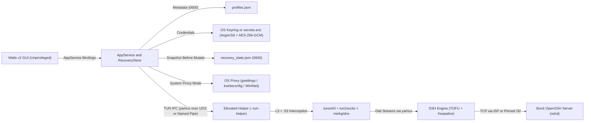

# tunssh

**`tunssh` is a minimalist, 1-click desktop SSH tunnel client that turns any stock OpenSSH server into a secure system-wide tunnel — no custom server daemon or agent required.**

Built with **Go**, **Wails v2**, and **React / TypeScript**, `tunssh` runs as a compact dark-first desktop app (`460×680`) with system tray integration and two traffic modes: an unprivileged **System Proxy Mode** and a full-device **Full TUN Mode**.

---

## Key Capabilities

- **Zero Server-Side Setup:** Connects directly to stock Linux `sshd` (`AllowTcpForwarding yes`) over standard SSH.
- **PAM & Private Key Auth:** Supports password + PAM `keyboard-interactive` (`maxKbdInteractiveRounds = 3`) as well as OpenSSH, PEM, and PKCS#8 private keys (`ed25519`, `ecdsa`, `rsa`; `.ppk` is rejected with an actionable prompt).
- **Resilient Connection Engine:**
  - Active `keepalive@openssh.com` watchdog (`10s` interval, `5s` timeout, drops after `2` missed ticks to clear zombie sockets).
  - Lock-free epoch-guarded auto-reconnect with bounded exponential backoff (`1s` → `30s` with jitter) and automatic halt on non-retryable auth/host-key errors.
- **Iran-Aware Diagnostics:** Maps common transport and SSH failures into actionable error codes (`ERR_PORT22_TIMEOUT`, `ERR_DPI_RESET`, `ERR_CONN_REFUSED`, `ERR_AUTH_FAILED`, `ERR_HOSTKEY_UNTRUSTED`, `ERR_HOSTKEY_MISMATCH`, `ERR_FORWARD_DISABLED`, `ERR_KEY_INVALID`, `ERR_NETWORK`).
- **System Tray Support:** Displays live connection state and lets you connect/disconnect, switch modes, trigger **Restore Network**, or hide the window while a tunnel stays active.

---

## Tunnel Modes

| Feature | System Proxy Mode (Default) | Full TUN Mode |
| :--- | :--- | :--- |
| **Privileges** | Unprivileged (no `pkexec` or UAC) | Elevated helper (`pkexec` / UAC) or Linux `CAP_NET_ADMIN` |
| **Local Data Plane** | Loopback SOCKS5 (`127.0.0.1:10808`) & HTTP CONNECT (`127.0.0.1:10809`) | Virtual NIC `tunssh0` + `tun2socks/v2` (gVisor netstack) |
| **DNS Handling** | Remote DNS via `socks5h` (`ATYP=0x03`) & HTTP `CONNECT host:port` | Embedded `miekg/dns` intercepting TUN `:53` queries |
| **UDP Traffic** | TCP-only via SOCKS5 `CONNECT` / HTTP `CONNECT` | DNS UDP `:53` intercepted; non-DNS UDP fast-dropped (`ErrUDPDropped`) |
| **Bypass Iran & LAN** | OS proxy bypass rules (`*.ir`, RFC 1918, loopback) | Split routes + embedded Iran IPv4 CIDRs + `.ir`/local DNS bypass |

### 1. System Proxy Mode (Unprivileged)

Starts loopback-only listeners on **`127.0.0.1:10808`** (SOCKS5 `NO-AUTH` with remote domain resolution `ATYP=0x03`) and **`127.0.0.1:10809`** (HTTP/HTTPS `CONNECT`), then automatically configures the OS proxy:

- **Linux:**
  - **GNOME / Ubuntu / Cinnamon / Budgie:** Configures `org.gnome.system.proxy` via `gsettings`.
  - **KDE Plasma 5 & 6:** Updates `kioslaverc` via `kwriteconfig6` (falling back to `kwriteconfig5`) and notifies KIO over D-Bus (`dbus-send`).
  - **Tiling WMs / XFCE / Headless (`manual-env`):** Leaves OS settings untouched and provides a one-click copyable shell snippet:
    ```sh
    export ALL_PROXY=socks5h://127.0.0.1:10808 HTTP_PROXY=http://127.0.0.1:10809 HTTPS_PROXY=http://127.0.0.1:10809
    ```
- **Windows:** Writes `ProxyEnable`, `ProxyServer`, and `ProxyOverride` under `HKCU\Software\Microsoft\Windows\CurrentVersion\Internet Settings` (snapshotting any existing `AutoConfigURL` before clearing it) and broadcasts changes via `wininet.dll` (`InternetSetOptionW`).
- **Dynamic `Bypass Iran & LAN`:** Adds `10.0.0.0/8`, `172.16.0.0/12`, `192.168.0.0/16`, and `*.ir` on Linux (alongside `localhost`, `127.0.0.0/8`, `::1`), or `10.*`, `172.16.*`–`172.31.*`, `192.168.*`, and `*.ir` on Windows (alongside `localhost`, `127.*`, `<local>`).

### 2. Full TUN Mode

Routes all device TCP traffic and DNS through SSH without configuring per-app proxies:

- **Virtual Interface (`tunssh0`):** Configured with RFC 2544 address `198.18.0.1/15`, MTU `1380` (to avoid PPPoE/LTE fragmentation), virtual DNS `198.18.0.2`, and ULA IPv6 `fd98:18::1/64` for IPv6 leak prevention (gracefully skipped if IPv6 is disabled on the host OS).
- **Packet Engine:** Powered by `github.com/xjasonlyu/tun2socks/v2` over `/dev/net/tun` (`netlink`) on Linux or SHA-256-verified **Wintun 0.14.1** (`wintun.dll`) on Windows. Non-DNS UDP packets are fast-rejected with `ErrUDPDropped` so browser QUIC/HTTP3 falls back cleanly to TCP.
- **Embedded `miekg/dns` Split Resolver:**
  - Listens on loopback UDP + TCP (`127.0.0.1:0`) while `CustomProxy` intercepts **all** TUN UDP and TCP `:53` traffic regardless of destination IP (capturing both OS DNS aimed at `198.18.0.2:53` and hardcoded app DNS destinations like `8.8.8.8:53`), redirecting queries to the local DNS listener and rewriting UDP reply source addresses back to the original destination.
  - **Tunnel Path:** Forwards queries via **DNS-over-TCP** (RFC 7766, pooled connections to `1.1.1.1:53` / `8.8.8.8:53`, `4s` timeout). The `dns` package also supports **DoH** (`https://1.1.1.1/dns-query`).
  - **Bypass Path (when `Bypass Iran & LAN` is enabled):** Routes queries for `.ir` (and `ir.`), `.local`, `.lan`, `.home.arpa`, `.in-addr.arpa`, and `.ip6.arpa` directly to pre-tunnel non-loopback ISP/local DNS servers via an interface-pinned `BypassDialer`.
  - **Bounded Cache:** Thread-safe LRU cache (`2,048` entries max, TTL clamped to `10s`–`300s`), partitioned between `tunnel` and `bypass` namespaces and flushed on bypass toggle or shutdown.
- **Loop-Free Split Routing:**
  - Resolves and pins `<VPSPeerIP>/32` (or `/128`) via the pre-tunnel gateway/interface **before** installing TUN split default routes (`0.0.0.0/1`, `128.0.0.0/1`, plus `::/1` and `8000::/1` when IPv6 is enabled), and binds the SSH socket to the physical egress interface (`SO_BINDTODEVICE` on Linux when permitted; `IP_UNICAST_IF` / `IPV6_UNICAST_IF` on Windows).
  - Routes RFC 1918/local prefixes (`10.0.0.0/8`, `172.16.0.0/12`, `192.168.0.0/16`, `169.254.0.0/16`, `224.0.0.0/4`) and, when `Bypass Iran & LAN` is active, the embedded Iranian IPv4 CIDR table (`internal/splitroute/cidrs_iran.go`) via the pre-tunnel gateway.
  - Configures OS DNS via `systemd-resolved` (`resolvectl`) or atomic `/etc/resolv.conf` backup/overwrite (`/etc/resolv.conf.tunssh.bak`) on Linux, and multi-adapter `netsh` + `DnsFlushResolverCache` on Windows.

---

## Security & Crash-Safety Architecture



- **Strict Secrets Isolation:** `profiles.json` (`0600`) stores metadata only. Passwords, private keys, and key passphrases live exclusively in the OS keyring (`github.com/zalando/go-keyring`, service `tunssh`) or, when no Secret Service daemon is available, an encrypted vault file (`secrets.enc`, `0600`) protected by **Argon2id** (`t=3`, `m=65536` KiB, `p=4`, 16-byte salt) + **AES-256-GCM** (12-byte nonce, AAD `"tunssh:secrets:v1"`).
- **Zero Secret Leakage:** No secrets appear in `profiles.json`, `recovery_state.json`, or `--tun-helper` CLI arguments. All application logs pass through `RedactingHandler` (`SecretScrubber` + 500-entry UI ring buffer), scrubbing active credentials, `sshtun://` URIs, PEM private-key blocks, and sensitive attribute keys (`password`, `secret`, `private_key`, `passphrase`, `share_link`, `token`).
- **Mandatory TOFU Host-Key Pinning:** Uses non-blocking `NewTOFUHostKeyCallback` with constant-time SHA-256 fingerprint verification (`ssh.InsecureIgnoreHostKey` is never used). Any host-key change triggers a hard mismatch alert rather than silently overwriting the pin.
- **Shareable `sshtun://v1/` Links:**
  - **Encrypted by default (`m: "enc"`):** Encodes profile metadata, optional pinned host key, and credentials with Argon2id + AES-256-GCM, binding envelope KDF parameters into AEAD AAD (`tunssh:share:v1:enc:t=...,m=...,c=...`) and enforcing strict pre-KDF bounds (`1 <= t <= 10`, `8192 <= m <= 262144` KiB, `1 <= c <= 16`, max `64 KiB` link size).
  - **Gated unencrypted mode (`m: "plain"`):** Disabled on both export and import unless explicitly confirmed by the user.
- **Least-Privilege Helper IPC (`--tun-helper`):** The GUI stays unprivileged (preserving keyring access, `HKCU` registry access, file dialogs, and `recovery_state.json` ownership) and communicates with the elevated helper over a multiplexed `hashicorp/yamux` session:
  - **Linux:** Creates a `0600` Unix domain socket inside a `0700` user-owned runtime/cache directory, launches `pkexec <exe> --tun-helper --socket <path>`, and verifies `SO_PEERCRED` (`Uid == 0`). If the binary already has `CAP_NET_ADMIN`, TUN runs directly in-process via `DirectTUNController`.
  - **Windows:** Creates a `FILE_FLAG_FIRST_PIPE_INSTANCE | FILE_FLAG_OVERLAPPED` Named Pipe (`\\.\pipe\tunssh-<hex>`) with SDDL `D:P(A;;GA;;;BA)(A;;GA;;;%s)` (granting access only to `BUILTIN\Administrators` and the GUI user SID), launches `tunssh.exe --tun-helper --pipe <name>` via `ShellExecuteExW` (`"runas"`), and verifies `GetNamedPipeClientProcessId` matches the spawned helper PID.
- **Crash-Safe Recovery:**
  - Before any OS proxy, route, or DNS change, the unprivileged GUI atomically writes (`temp` → `fsync` → `rename`) `recovery_state.json` (`dirty: true`) in the user config directory (`$XDG_CONFIG_HOME/tunssh/` / `~/.config/tunssh/` on Linux, `%APPDATA%\tunssh\` on Windows).
  - If the GUI crashes while TUN is active, the helper detects the closed `yamux` IPC channel, stops TUN, and restores OS routes/DNS automatically without altering `recovery_state.json` ownership.
  - On relaunch, `tunssh` inspects `recovery_state.json`, automatically restores dirty proxy state or checks whether TUN routes/DNS remain active, displays a recovery banner if needed, and keeps a persistent **Restore Network** panic button available in the UI footer and system tray.

---

## Installation

### Linux Releases

Download the latest release package for `amd64` or `arm64` from [GitHub Releases](https://github.com/AlirezaDelkhahi/tunssh/releases):

- **Debian / Ubuntu:** `.deb` (`dpkg -i` / `apt install ./tunssh_*.deb`)
- **Fedora / RHEL:** `.rpm` (`dnf install ./tunssh-*.rpm`)
- **Arch Linux:** `.pkg.tar.zst` (`pacman -U ./tunssh-*.pkg.tar.zst`)
- **Portable Archive:** `.tar.gz` containing the `tunssh` binary, `tunssh.desktop`, and `tunssh.svg`

Verify your download against `SHA256SUMS.txt`:

```sh
sha256sum -c SHA256SUMS.txt --ignore-missing
```

### Windows

Download `tunssh-<version>-windows-amd64.zip` (or `tunssh-<version>-windows-arm64.zip` on ARM64 Windows) from [GitHub Releases](https://github.com/AlirezaDelkhahi/tunssh/releases):

1. Extract the `.zip` archive into a dedicated folder, keeping **`tunssh.exe`** and the bundled SHA-256-verified **`wintun.dll`** (`Wintun 0.14.1`) in the **same directory** (verify downloads against `SHA256SUMS.txt`).
2. Ensure the **Microsoft Edge WebView2 Runtime** is installed (preinstalled on Windows 11 and modern Windows 10).
3. Launch `tunssh.exe` as a standard user: **System Proxy** mode works unprivileged, while **Full TUN** prompts via Windows UAC to launch the elevated helper (`--tun-helper`).
   *(Note: Windows builds are cross-compiled and verified via CI on every release; live Windows runtime smoke testing is still in progress.)*

---

## Quick Start & OpenSSH Server Setup

### 1. Prepare Your OpenSSH Server

Any standard Linux VPS running OpenSSH (`sshd`) works out of the box as long as TCP forwarding is enabled in `/etc/ssh/sshd_config`:

```sshconfig
AllowTcpForwarding yes
```

> **Tip for Restrictive Networks:** On networks that throttle or block TCP port `22`, configure `sshd` to also listen on an alternate port such as `443`, `2053`, or `8443` (and allow it in your VPS firewall), then set that port in your `tunssh` profile.

### 2. Connect & Choose a Mode

1. Open `tunssh` and create a profile (or paste an `sshtun://v1/...` share link).
2. Choose **System Proxy (No Admin)** or **Full TUN (All Apps)**.
3. Click **Connect**. On first connection, verify the server's SHA-256 host-key fingerprint in the **Verify Server Host Key** modal and click **Trust & Connect**.
4. Closing the window while connected minimizes `tunssh` to the system tray (when a tray is available on your desktop session).

### 3. Linux Elevation Options for Full TUN

- **Per-Session `pkexec` (Default):** Prompts via polkit when starting Full TUN and runs routes/DNS in the elevated `--tun-helper` process.
- **Optional Persistent TUN Access:** In the UI, **Enable One-Time Persistent TUN Access** runs `pkexec setcap cap_net_admin,cap_net_bind_service+ep <binary>` so `/dev/net/tun` and `netlink` routing work without repeated password prompts.
  - **Distro Caveat:** On some Linux setups, `systemd-resolved` (`resolvectl` / polkit policy) or writing `/etc/resolv.conf` still requires root or polkit authorization even with file capabilities. If DNS configuration fails in persistent mode, clear the capabilities to return to `pkexec` helper elevation:
    ```sh
    sudo setcap -r /usr/bin/tunssh
    ```

### 4. Emergency Network Cleanup

If an unclean shutdown, power loss, or OS crash ever leaves system proxy settings, split routes, or TUN DNS entries behind, open `tunssh` (or use its tray menu) and click **Restore Network**.

---

## Building & Testing from Source

### Prerequisites (Linux)

Matches [`.github/workflows/ci.yml`](.github/workflows/ci.yml):

- **Go:** `1.26.3` (see [`go.mod`](go.mod))
- **Node.js:** `22` (with `npm`)
- **System Libraries (Debian/Ubuntu):**
  ```sh
  sudo apt-get update
  sudo apt-get install -y libgtk-3-dev libwebkit2gtk-4.1-dev libayatana-appindicator3-dev pkg-config
  ```
- **Optional (for `make package-linux` / Windows `.exe` icon & DPI manifest):**
  ```sh
  go install github.com/goreleaser/nfpm/v2/cmd/nfpm@latest
  go install github.com/tc-hib/go-winres@latest
  ```

### Makefile Targets

```sh
# Run Go test suite with race detector
make test

# Run go vet (cross-platform packages + webkit2_41 desktop build tags)
make vet

# Build frontend (tsc + vite) and Linux desktop binary -> bin/tunssh
make build-linux

# Package .tar.gz, .deb, .rpm, .pkg.tar.zst, and SHA256SUMS.txt -> dist/
make package-linux

# Fetch/verify Wintun 0.14.1 DLL and cross-compile Windows binary -> bin/tunssh.exe
# (embeds packaging/winres/winres.json icon + DPI manifest when go-winres is installed)
make build-windows

# Package tunssh-<version>-windows-<arch>.zip (tunssh.exe + wintun.dll) and SHA256SUMS.txt -> dist/
make package-windows

# Remove bin/ and dist/
make clean
```

---

## Project Layout & Documentation

```text
tunssh/
├── cmd/tunssh/               # Desktop entrypoint, --tun-helper mode, system tray controller
├── internal/
│   ├── app/                  # Wails-bound AppService, helper IPC (yamux/UDS/Named Pipe), log redactor
│   ├── crypto/               # Argon2id + AES-256-GCM helpers & sshtun://v1/ share-link codec
│   ├── dns/                  # Embedded miekg/dns :53 resolver, LRU TTL cache, .ir/local bypass
│   ├── profile/              # Profile metadata (profiles.json) & SecretStore (keyring + secrets.enc)
│   ├── proxy/                # Loopback SOCKS5 (socks5h) & HTTP CONNECT servers
│   ├── recovery/             # Atomic recovery_state.json & idempotent OS network restorer
│   ├── splitroute/           # Pre-TUN /32 pinning, split routes, Iran CIDR table, Linux/Windows DNS
│   ├── sshclient/            # SSH engine, PAM/key auth, TOFU pinning, watchdog, Iran-aware errors
│   ├── sysproxy/             # OS system proxy backends (WinINet, GNOME gsettings, KDE, manual-env)
│   └── tun/                  # tun2socks/v2 + gVisor stack over /dev/net/tun & SHA-256-verified Wintun
├── frontend/                 # Wails v2 React 18 + TypeScript + Vite 6 UI
├── packaging/                # nfpm.yaml (.deb/.rpm/.pkg.tar.zst), fetch-wintun.sh, winres, desktop entry & SVG
├── .github/workflows/        # CI (ci.yml) and multi-arch release pipeline (release.yml)
└── ARCHITECTURE.md           # Detailed architectural blueprint and design invariants
```

For deeper design invariants and protocol details, see [ARCHITECTURE.md](ARCHITECTURE.md).

---

## License

MIT License.
